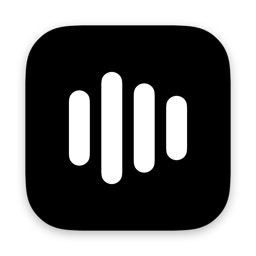
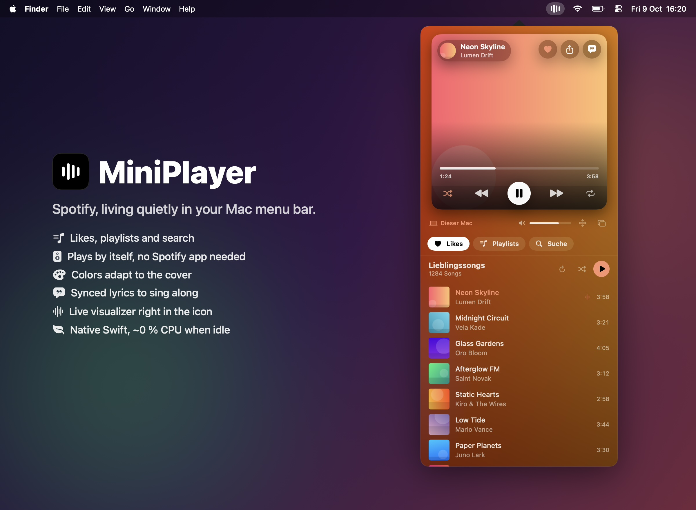
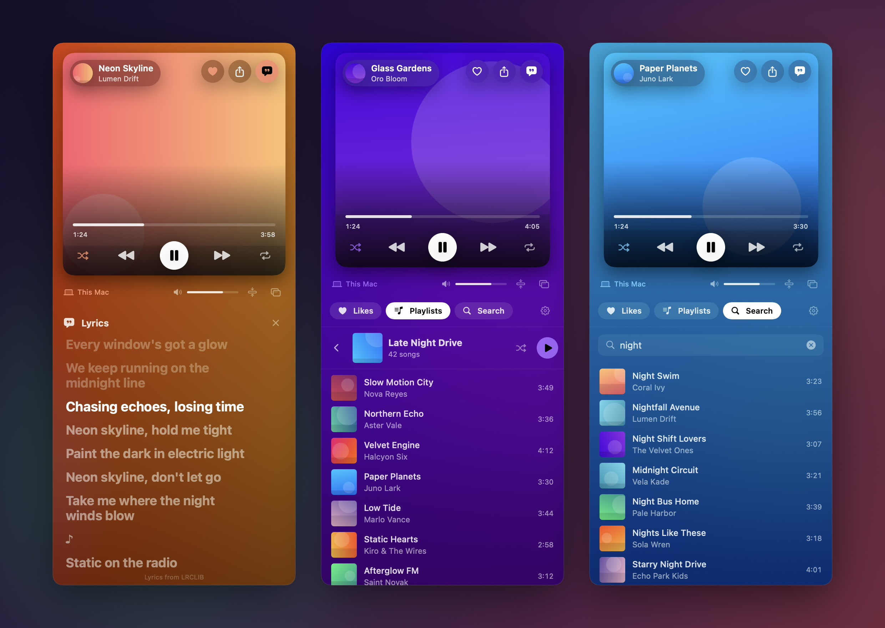
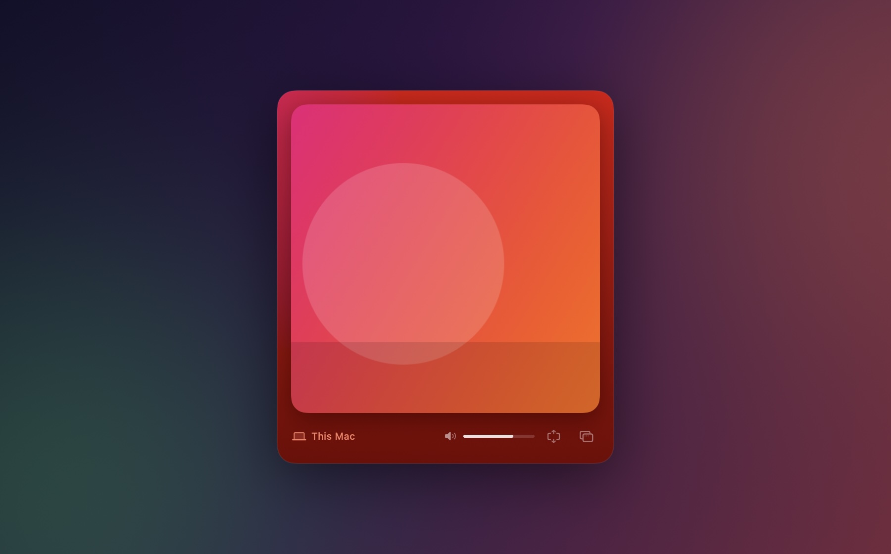
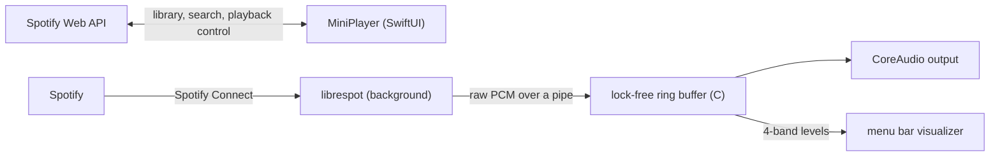

<div align="center">



# MiniPlayer

**A tiny native Spotify player that lives in your Mac menu bar.**

Browse your likes and playlists, search for new music and play it, without the Spotify app.




</div>

## Features

- **Lives in the menu bar.** No Dock icon and no window. Click the icon and the player folds out.
- **Cover in focus.** The artwork fills the player, and the whole interface takes on its colors like ambient light.
- **Sing along.** Time-synced lyrics that scroll with the music; tap a line to jump there.
- **Pop it out.** Detach the player into a floating window, or hide the library for a clean, cover-only view.
- **Your library.** Liked songs, playlists and search, with infinite scrolling.
- **Plays by itself.** A bundled [librespot](https://github.com/librespot-org/librespot) engine runs invisibly as the Spotify Connect device "MiniPlayer". No Spotify app needed.
- **Live visualizer in the icon.** Four bars (bass → treble) dance to whatever is playing.
- **Full control.** Play/pause, skip, seek, volume, shuffle, repeat, like, queue, and switching between your Spotify Connect devices.
- **Share.** Send the current song via Messages, Mail, AirDrop and more, straight from the cover.
- **Light on resources.** Native Swift/SwiftUI with no polling while closed. See the [measurements](#performance).

<div align="center">

<br><br>

<br><br>

</div>

> The app's interface is in German.

## Requirements

- macOS 14 Sonoma or later (developed on macOS 26)
- Xcode 15.3 or later (Swift 5.10+)
- **Spotify Premium.** Since February 2026, Spotify only enables self-made developer apps for Premium accounts, and librespot requires Premium too.
- [Homebrew](https://brew.sh) for librespot

## Installation

```bash
git clone https://github.com/iFeaturemusic/Mini-Spotify-Player-.git
cd Mini-Spotify-Player-
brew install librespot
./build.sh install
```

`build.sh` builds the app, bundles librespot into it, signs it and copies it to `/Applications`. A 🎵 icon appears in your menu bar.

If a *Developer ID* or *Apple Development* certificate is available, it is used for signing so macOS only asks for Keychain access once. Otherwise the app is signed ad-hoc.

### Sharing the app with others

```bash
./build.sh dist
```

This creates `build/MiniPlayer.zip`, signed with your *Developer ID* (hardened runtime and secure timestamp). If notarization credentials are stored, it is also notarized and stapled, so it opens on other Macs without Gatekeeper warnings. Store the credentials once with an app-specific password from [account.apple.com](https://account.apple.com):

```bash
xcrun notarytool store-credentials MiniPlayer --apple-id <your Apple ID> --team-id <your team ID>
```

The bundled librespot binary is Apple Silicon only, so the app runs on M1 or newer.

## Setup

You need your own Spotify developer app. It takes about two minutes.

1. Open the [Spotify Developer Dashboard](https://developer.spotify.com/dashboard) and click **Create app**.
2. Choose any name and description, and set the **Redirect URI** to:
   ```
   http://127.0.0.1:8898/callback
   ```
3. Under *Which API/SDKs are you planning to use?*, select **Web API** and save.
4. Copy the app's **Client ID**, click the 🎵 icon and paste it in.
5. Click **Mit Spotify anmelden** (sign in with Spotify) and confirm in the browser.
6. Click **Aktivieren** (activate) on the "Eingebauter Player" card and confirm once more in the browser. This is librespot's own login; its credentials are cached afterwards.

That's it. Pick a song and it plays right from MiniPlayer.

## Usage

| | |
|---|---|
| **Left-click** the icon | Open or close the player |
| **Right-click** the icon | Pop out / back to menu bar · Launch at login · Visualizer on/off · Sign out · Change Client ID · Quit |
| <kbd>⤢</kbd> button next to the volume | Hide the library and show only the cover (controls appear on hover) |
| <kbd>⧉</kbd> button next to the volume | Pop the player out into a floating window, or put it back into the menu bar |
| Drag the cover | Move the detached window |
| <kbd>⌘W</kbd> | Close the popover or hide the detached window (click the menu bar icon to bring it back) |
| Device button (bottom left of the player) | Switch playback to your phone, speakers and other devices |
| <kbd>↑</kbd> button on the cover | Share the current song (Spotify link with cover preview) |
| Right-click a song | Add to queue, like or unlike, share, copy link |

## Performance

Measured on an Apple Silicon MacBook running macOS 26:

| State | CPU |
|---|---|
| Player closed, nothing playing | ~0 % |
| Music playing, visualizer on | MiniPlayer 2.5 %, librespot 0.6 % |
| Music playing, visualizer off | MiniPlayer 0.7 % |

Memory use is about 50–90 MB for MiniPlayer and about 65 MB for librespot.

<details>
<summary>Why the visualizer is built the way it is</summary>

On macOS 26 only the active menu bar shows the real status item. Other displays show a snapshot copy, and every redraw of the icon creates a new snapshot. That costs about 0.8 % CPU per update per second, so redrawing 20 times per second would cost around 16 %.

MiniPlayer therefore animates the bars as Core Animation layers, which the system composites directly without redrawing the icon. The copies on other displays are refreshed only twice per second.

</details>

## How it works



- **Login:** Authorization Code flow with PKCE, so no client secret is involved. A tiny local server on `127.0.0.1:8898` runs only during login to receive the redirect.
- **Playback:** librespot outputs raw float PCM (`--backend pipe`). MiniPlayer plays it through `AVAudioEngine` and measures four frequency bands in the real-time render callback. The audio engine stops 3 seconds after playback pauses.
- **Polling:** state is only polled while the player is open. The progress bar is interpolated locally.
- **Ambient colors:** on every track change the cover is blurred and saturated with Core Image for the background, and the most vivid hue becomes the accent color. This runs once per track.
- **Lyrics:** fetched from [LRCLIB](https://lrclib.net) only while the lyrics view is open, cached per track and highlighted line by line (with a small offset for MiniPlayer's own audio buffer).

## Privacy

- MiniPlayer talks to Spotify and, only while the lyrics view is open, to [LRCLIB](https://lrclib.net), which receives the title, artist and duration of the current song. There is no telemetry.
- The refresh token is stored in the macOS **Keychain**. Access tokens are kept in memory only.
- librespot's credentials live in `~/Library/Application Support/MiniPlayer/librespot` (folder permissions `0700`).
- Logs in `~/Library/Logs/MiniPlayer/` contain errors and status events only, never tokens or search terms.
- Signing out removes both the Keychain token and librespot's credentials.

## Troubleshooting

| Problem | Fix |
|---|---|
| Every request fails with `403 forbidden` | The account that owns the developer app needs Spotify Premium. Other accounts must be added under *User Management* in the dashboard. |
| "INVALID_CLIENT: Invalid redirect URI" | The redirect URI must be exactly `http://127.0.0.1:8898/callback`. |
| Port 8898 is busy | Another app is using the port. Quit it and try again. |
| "No lyrics found" | LRCLIB is community-run, so niche tracks and remixes are often missing. You can add lyrics on [lrclib.net](https://lrclib.net). |
| Songs of a playlist aren't listed | Spotify only lists items of playlists you own or collaborate on (2026 API change). Playing the whole playlist still works. |

Run the built-in self-test to check login, library, lyrics, search and devices:

```bash
/Applications/MiniPlayer.app/Contents/MacOS/MiniPlayer --selftest
```

Add `--play` to also run a short playback test on the "MiniPlayer" device (at 25 % volume).

## Development

```
Sources/
  AudioRing/            lock-free ring buffer + band analysis (C, real-time safe)
  MiniPlayer/
    App.swift            entry point (accessory app, no Dock icon)
    AppDelegate.swift    status item, popover, context menu, visualizer
    AppStore.swift       wires everything together
    SpotifyAuth.swift    OAuth PKCE + token refresh
    LoopbackServer.swift local redirect receiver used during login
    SpotifyAPI.swift     Web API client (401 refresh, 429 retry)
    PlayerModel.swift    playback state and commands
    Artwork.swift        cover, ambient backdrop and accent color
    Lyrics.swift         LRCLIB lookup and LRC parsing
    LibraryModel.swift   likes, playlists, search
    PlaybackEngine.swift starts and supervises librespot
    PlayerWindow.swift   floating window for the detached player
    AudioOutput.swift    PCM → CoreAudio, visualizer levels
    Views/               SwiftUI interface
```

```bash
swift build                                              # debug build
./build.sh                                               # app bundle in build/
swift build && .build/debug/MiniPlayer --screenshots docs/images   # regenerate README images
```

The README images are rendered from the real SwiftUI views with fictional demo data.

## Credits

- [librespot](https://github.com/librespot-org/librespot), the open-source Spotify Connect client (MIT)
- [LRCLIB](https://lrclib.net), the free, community-run synced lyrics database

## Disclaimer

MiniPlayer is an independent hobby project and is not affiliated with, endorsed by or connected to Spotify AB. "Spotify" is a trademark of Spotify AB. librespot is an unofficial client. Use it in accordance with Spotify's terms of service.

## License

[MIT](LICENSE) © iFeature
